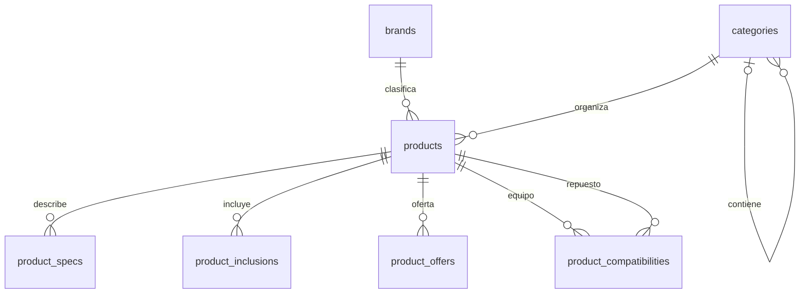
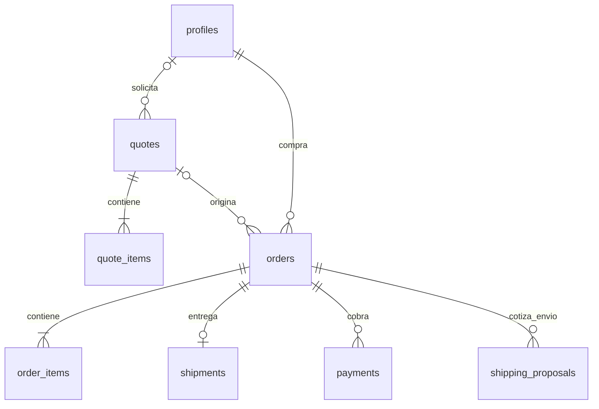
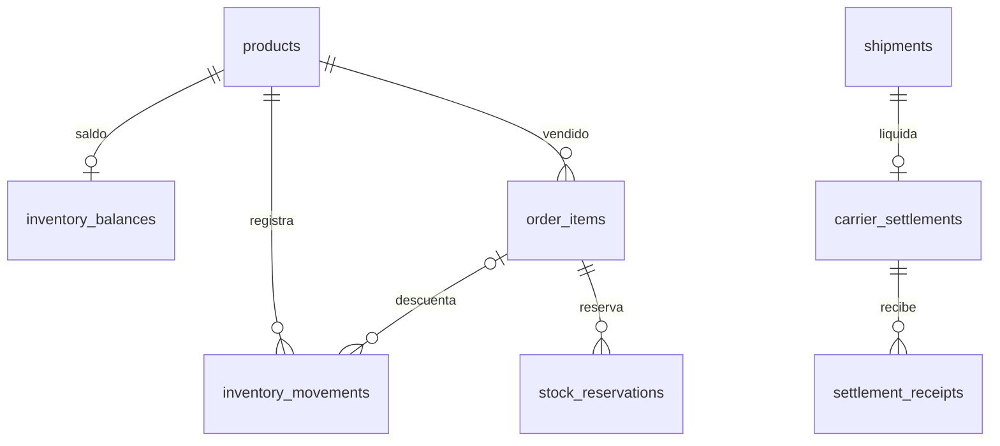
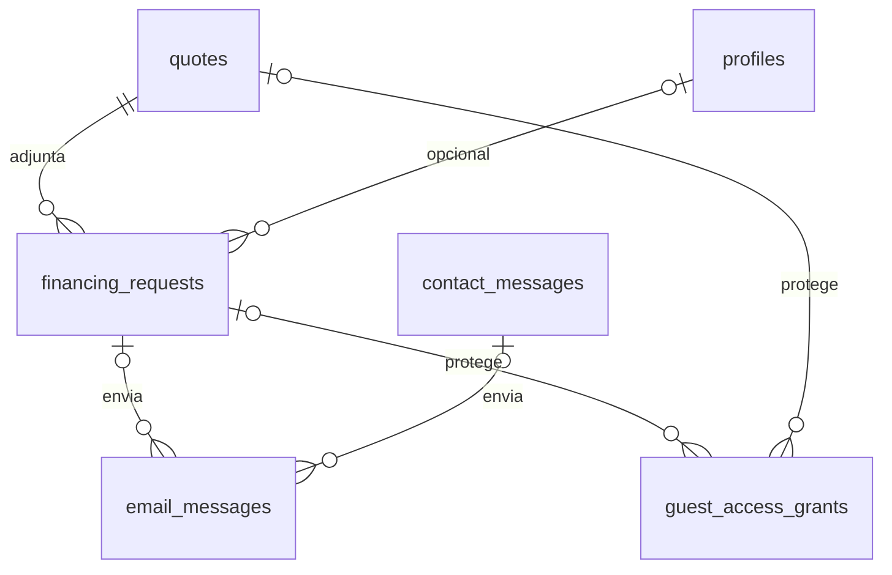

# GreenBel — Modelo de datos · Etapa 3

> **Decisión vigente · 29/09/2026:** solo el envío real de correos está temporalmente pausado en DEV y PROD. Se integrará después con Resend al configurar el dominio. Continúan formularios, PDF, validaciones y persistencia. No simular correo verificado ni envío exitoso. Contacto se registra sin notificación y financiamiento queda en borrador. No enviar automáticamente registros acumulados al reactivar. Ver GreenBel_Correos_Verificacion_Financiamiento.md.

**Versión 0.4 · 29/09/2026 · Propuesta para revisión.** No se han ejecutado migraciones ni modificado bases. Este documento propone el modelo; no convierte en aprobadas las decisiones todavía pendientes.

## 1. Decisiones técnicas confirmadas

| Componente | Decisión del usuario |
| --- | --- |
| Aplicación | Next.js con TypeScript (confirmado por el usuario) |
| Backend y base de datos | Supabase y PostgreSQL |
| Autenticación | Supabase Auth, inicialmente correo y contraseña |
| Hosting | Vercel |
| Correos | Resend, integración de envío pospuesta |
| Ambientes | Dos bases/proyectos separados: DEV y PROD |
| Pagos | Modo de pruebas inicial; Recurrente previsto, no confirmado definitivamente |

Fuentes funcionales: GreenBel_Reglas_Negocio_Etapa_1.md v1.0 y GreenBel_Secciones_Flujos_Etapa_2.md v0.4. Las decisiones posteriores de etapa 2 prevalecen en presentación del catálogo. El pendiente PEN-01 de etapa 1 queda resuelto por las confirmaciones técnicas de esta conversación.

## 2. Criterios y límites del modelo propuesto

- Auth administra credenciales. No crear una tabla propia de contraseñas.
- Un registro de producto por artículo vendible/SKU, sea equipo, accesorio o repuesto. Variantes con selección combinada no están aprobadas; cada SKU puede ser un producto independiente inicialmente.
- Precio ausente se representa con NULL, no cero. Publicación y precio son independientes: un producto publicado con precio NULL muestra «Precio próximamente», sin botón de consulta añadido.
- Propuesta pendiente: impedir finalizar compra, cotización monetaria y financiamiento de líneas sin precio; no inventar importes. La etiqueta pública sí está aprobada.
- Un inventario global, sin almacenes, traslados, lotes ni números de serie.
- El carrito se conserva inicialmente en el navegador (SKU y cantidades), sin una tabla adicional. Es reutilizable entre compra/cotización/financiamiento, pero el servidor siempre recalcula. No promete sincronización entre dispositivos.
- Una cotización o pedido emitido conserva copias de sus datos comerciales. No reconstruir documentos históricos con el catálogo actual.
- Propuesta inicial: un destino y un envío por pedido, sin entregas parciales. Confirmar antes de implementarlo; un retorno no crea una segunda venta.
- Evitar borrados físicos de catálogo usado en operaciones: archivar. No borrar en cascada pedidos, pagos o cotizaciones por retirar un producto.
- Los JSONB propuestos son documentos acotados con esquema validado, no sustitutos de relaciones entre productos, pedidos, pagos e inventario.

## 3. Convenciones del diccionario

- Toda tabla, salvo excepciones indicadas, tiene `id uuid PK`, `created_at timestamptz NOT NULL` y `updated_at timestamptz NOT NULL`.
- `?` significa nullable. Campos sin `?` son obligatorios. FK indica clave foránea al `id` de la tabla citada. UQ significa restricción única.
- `money` en este documento significa `numeric(14,2)`, no el tipo PostgreSQL money. `qty` significa `numeric(14,3)`; cada producto indica si admite fracciones, inicialmente propuesto false para equipos/repuestos.
- Estados se almacenan como `text` con lista validada, evitando aceptar valores arbitrarios. Los nombres en inglés son propuesta técnica; las etiquetas visibles estarán en español.
- Fechas en UTC, presentación y vigencias interpretadas en America/Guatemala. Moneda `char(3)` obligatoria en cada documento comercial; confirmar GTQ e impuestos antes de activar cobros.
- Todo actor `*_by uuid?` referencia `profiles.id`; NULL solo representa operación del sistema o actor eliminado mediante procedimiento controlado, no pérdida silenciosa de auditoría.
- Cada FK necesita índice salvo que ya sea primera columna de una PK/UQ/índice equivalente. Las reglas entre filas y sumas se validan en transacciones, no se confían al formulario.

## 4. Usuarios y contenido

| Tabla y propósito | Campos específicos | Restricciones e índices |
| --- | --- | --- |
| `profiles`: información de cuenta | `id uuid PK/FK auth.users.id`, `display_name text`, `phone text?`, `active boolean` | Relación Auth 1:0..1 perfil; perfil requerido antes de comprar. No repetir contraseña ni tomar rol de metadatos editables |
| `user_roles`: autoridad de acceso | `user_id uuid PK/FK profiles`, `role text` | Una función por cuenta: customer/operator/admin. Sin id adicional; registro normal solo customer, cambios reservados al administrador autorizado |
| `site_content`: contenido institucional acotado | `key text UQ`, `title text`, `body jsonb`, `publication_status text`, `edited_by uuid?` | Claves y esquema permitidos para Inicio, Nosotros y Contacto; no HTML/JS arbitrario ni secretos |
| `operational_settings`: parámetros internos | `key text UQ`, `value jsonb`, `edited_by uuid?` | Claves tipadas para plazos y opciones operativas; permisos internos. No guardar claves API aquí |

Auth puede tener usuarios aún sin perfil por proceso incompleto: impedir operaciones comerciales hasta provisionarlo idempotentemente. Eliminar una cuenta exige política de retención/anónimo histórico pendiente; no cascada de transacciones. `user_roles` no es un editor de permisos personalizables.

## 5. Catálogo, ofertas y capacitaciones

| Tabla y propósito | Campos específicos | Restricciones e índices |
| --- | --- | --- |
| `brands`: marcas | `name text`, `slug text UQ`, `logo_path text?`, `active boolean` | Nombre normalizado único propuesto |
| `categories`: categorías y subcategorías | `parent_id uuid? FK categories`, `name text`, `slug text UQ`, `sort_order integer`, `active boolean` | No ciclos ni padre propio; raíz tiene parent NULL. Profundidad final pendiente |
| `products`: cada artículo vendible | `sku text UQ`, `slug text UQ`, `name text`, `model text?`, `kind text`, `brand_id uuid? FK brands`, `category_id uuid FK categories`, `short_description text?`, `description text?`, `regular_price money?`, `currency char(3)`, `allows_fractional boolean`, `warranty_months integer?`, `warranty_terms text?`, `shipping_weight_kg numeric(10,3)?`, `shipping_dimensions jsonb?`, `publication_status text` | kind equipment/part/accessory; precio NULL o >0; dimensiones positivas y formato definido. Índices category, brand, status; búsqueda por nombre/modelo/SKU. Peso embalado distinto del peso técnico del equipo |
| `product_images`: galería | `product_id uuid FK products`, `storage_path text`, `alt_text text`, `sort_order integer`, `is_primary boolean` | Índice product/order; UQ parcial una principal por producto |
| `product_specs`: ficha técnica | `product_id uuid FK products`, `label text`, `value text`, `unit text?`, `sort_order integer` | Valor texto permite rangos y tipos de motor; no exigir número a toda especificación |
| `product_inclusions`: bloque Incluye | `product_id uuid FK products`, `description text`, `quantity qty`, `sort_order integer` | Cantidad >0. Descriptivo: no descuenta piezas del inventario automáticamente |
| `product_compatibilities`: equipo y repuesto | `equipment_id uuid FK products`, `part_id uuid FK products`, `notes text?` | PK compuesta equipment/part, sin id extra; no autorrelación; validar tipos y correspondencia. Índice inverso part/equipment |
| `product_offers`: promociones | `product_id uuid FK products`, `kind text`, `value numeric(14,2)`, `starts_at timestamptz`, `ends_at timestamptz`, `enabled boolean`, `created_by uuid?` | fixed_price o percentage; inicio < fin; 0<%<100, precio final >0 y <regular. No intervalos habilitados superpuestos por producto; exclusión temporal o bloqueo transaccional equivalente |
| `trainings`: videos públicos | `slug text UQ`, `title text`, `description text?`, `cover_path text?`, `video_url text?`, `video_storage_path text?`, `publication_status text` | Una fuente de video, no ambas; publicación requiere fuente válida. Proveedor de video pendiente |
| `training_products`: videos por producto | `training_id uuid FK trainings`, `product_id uuid FK products` | PK compuesta, sin id extra; índice inverso product/training |
| `training_categories`: videos por categoría | `training_id uuid FK trainings`, `category_id uuid FK categories` | PK compuesta, sin id extra; índice inverso category/training |

Publicación propuesta: draft → published → archived; permitir despublicar a draft sin borrar historial. Un producto sin precio puede estar published. Las ofertas no pueden activarse sobre precio NULL. Cambiar precio base exige revisar la promoción y no puede generar dos ofertas simultáneas.

## 6. Entrega y medios de pago

| Tabla y propósito | Campos específicos | Restricciones e índices |
| --- | --- | --- |
| `delivery_services`: retiro, mensajería propia o servicio externo | `name text`, `kind text`, `carrier_name text?`, `active boolean`, `cod_limit money?`, `commission_percent numeric(6,3)?`, `commission_min money?`, `commission_notes text?`, `pickup_details jsonb?` | kind pickup/own_delivery/external. Un retiro activo propuesto mediante UQ parcial. No sembrar tarifas de Forza como hechos contractuales |
| `delivery_zones`: cobertura | `code text UQ`, `name text`, `department text`, `municipality text`, `zone_detail text?`, `active boolean` | Coincidencia de destino validada, no resolver únicamente por texto libre |
| `service_zone_rates`: servicio y tarifa por destino | `service_id uuid FK delivery_services`, `zone_id uuid FK delivery_zones`, `pricing_mode text`, `shipping_fee money?`, `currency char(3)`, `shipping_charge_mode text`, `active boolean` | UQ service/zone; fixed requiere fee>=0; manual admite NULL; charge_mode with_order/at_destination/customer_choice. Zona sin servicio activo no es gratis |
| `service_payment_options`: combinaciones permitidas | `service_id uuid FK delivery_services`, `method text`, `timing text`, `active boolean` | UQ service/method/timing. method online_gateway/cash/terminal/carrier_cod; timing prepaid/on_delivery/on_pickup; validar según servicio |

Retiro cuesta cero y no exige zona de cobertura. Si una tarifa por peso/dimensión no se puede obtener de una tarifa fija aprobada, se usa cotización manual en esta versión. Elegir método no crea integración automática con el proveedor.

## 7. Cotizaciones y pedidos históricos

| Tabla y propósito | Campos específicos | Restricciones e índices |
| --- | --- | --- |
| `quotes`: documento emitido | `reference text UQ`, `user_id uuid? FK profiles`, `recipient_name text`, `email text?`, `currency char(3)`, `subtotal money`, `discount_total money`, `shipping_status text`, `shipping_amount money?`, `total money`, `terms_snapshot jsonb`, `supersedes_id uuid? FK quotes`, `pdf_path text?`, `issued_at timestamptz`, `idempotency_key text UQ` | Emitida inmutable; revisión crea otra fila. Transporte unknown/excluded/included; PDF pendiente de generación no se presenta como listo. total explicita qué incluye; no precio garantizado por plazo inventado |
| `quote_items`: líneas congeladas | `quote_id uuid FK quotes`, `product_id uuid FK products`, `line_no integer`, `sku_snapshot text`, `name_snapshot text`, `quantity qty`, `regular_unit_price money`, `discount_unit money`, `final_unit_price money`, `line_total money`, `offer_snapshot jsonb?` | UQ quote/line; qty>0, precios y descuentos coherentes; suma de líneas validada con cabecera |
| `orders`: compra o solicitud previa de envío | `reference text UQ`, `customer_id uuid FK profiles`, `source_quote_id uuid? FK quotes`, `stage text`, `currency char(3)`, `customer_snapshot jsonb`, `billing_snapshot jsonb`, `delivery_service_id uuid FK delivery_services`, `delivery_zone_id uuid? FK delivery_zones`, `delivery_snapshot jsonb`, `payment_method_snapshot jsonb`, `subtotal money`, `discount_total money`, `shipping_fee money?`, `shipping_charge_mode text`, `amount_due_greenbel money?`, `amount_due_carrier_shipping money?`, `customer_total money?`, `confirmed_at timestamptz?`, `idempotency_key text UQ`, `version integer` | Índices customer/date y stage/date. Antes de aceptación manual permite total NULL; confirmada requiere todos los importes pertinentes definidos y verificables. Cliente no escribe importes/estados directamente |
| `order_items`: líneas de pedido | `order_id uuid FK orders`, `product_id uuid FK products`, `line_no integer`, `sku_snapshot text`, `name_snapshot text`, `quantity qty`, `regular_unit_price money`, `discount_unit money`, `final_unit_price money`, `line_total money`, `warranty_snapshot jsonb?`, `offer_snapshot jsonb?` | UQ order/line; inmutables al confirmar. FK permite vincular reseñas e inventario sin perder el contenido histórico |
| `shipping_proposals`: cotizaciones manuales de transporte | `order_id uuid FK orders`, `revision integer`, `fee money`, `currency char(3)`, `charge_mode text`, `status text`, `proposed_by uuid?`, `accepted_at timestamptz?`, `accepted_by uuid?`, `terms_snapshot jsonb` | UQ order/revision; oferta nueva sustituye anterior no aceptada; aceptación verifica versión vigente y precio/disponibilidad de productos |
| `shipments`: ejecución de entrega | `order_id uuid UQ FK orders`, `status text`, `carrier_snapshot text?`, `tracking_number text?`, `tracking_url text?`, `cod_amount money?`, `dispatched_at timestamptz?`, `delivered_at timestamptz?`, `received_back_at timestamptz?`, `updated_by uuid?` | Pedido 1:0..1 envío/retiro en propuesta inicial. La guía no es universalmente única entre empresas. No marcar cobro solo por entregar |

### Formatos JSON históricos propuestos

- `customer_snapshot`: nombre, correo, teléfono. Identifica al comprador al confirmar, aunque cambie su perfil.
- `billing_snapshot`: campos de facturación que confirme GreenBel; no almacenar un esquema fiscal inventado.
- `delivery_snapshot`: modalidad, nombre del servicio, destinatario, dirección, referencias, punto/horario de retiro, términos de cobertura y cargos aceptados. Validar según modalidad.
- `payment_method_snapshot`: código de método y momento de cobro, sin credenciales ni tarjetas.
- `offer_snapshot`: tipo, valor, precio base y descuento aplicado. No depender de la oferta actual.
- `terms_snapshot`: condiciones publicadas y versión del texto aceptado; ningún JSON acepta claves arbitrarias del cliente.

Redondear descuento unitario y precio final unitario a dos decimales; calcular cada total de línea como round(precio final unitario × cantidad, 2), con política única de redondeo en servidor. Para cantidades fraccionarias, subtotal y descuento se concilian contra los totales de línea, sin confiar en aritmética de coma flotante del navegador.

`subtotal` es suma de precio regular × cantidad; `discount_total` es suma de descuentos; mercancía neta = subtotal − discount_total. `amount_due_greenbel` incluye mercancía y solo transporte que GreenBel cobre. `amount_due_carrier_shipping` incluye transporte cobrado directamente por tercero. `customer_total` es su suma. Para COD el transportista puede recaudar también el importe debido a GreenBel: eso no transforma el producto en un segundo cargo. Registrar la instrucción exacta aceptada y no deducirla del nombre del método.

## 8. Inventario global y reservas

| Tabla y propósito | Campos específicos | Restricciones e índices |
| --- | --- | --- |
| `inventory_balances`: saldo vendible base y apartado | `product_id uuid PK/FK products`, `stock_balance qty`, `reserved qty` | Sin id extra; stock_balance>=0; 0<=reserved<=stock_balance; disponible=stock_balance−reserved. No llamarlo conteo físico: pagos consolidados pueden seguir en tienda |
| `inventory_movements`: registro de entradas/descuentos/reintegros | `product_id uuid FK products`, `kind text`, `quantity_delta qty`, `reason text`, `reference text?`, `order_item_id uuid? FK order_items`, `case_item_id uuid? FK service_case_items`, `actor_id uuid? FK profiles`, `idempotency_key text UQ` | delta distinto de 0; eventos inmutables, correcciones con contramovimiento; índice product/date y order_item. No borrar movimientos |
| `stock_reservations`: unidades apartadas | `order_item_id uuid FK order_items`, `attempt_no integer`, `quantity qty`, `status text`, `expires_at timestamptz?`, `review_due_at timestamptz?`, `consumed_at timestamptz?`, `released_at timestamptz?` | UQ order_item/attempt; UQ parcial una reserva active por línea; índice status/expiry. COD usa revisión, no caducidad automática de pasarela |

### Algoritmo transaccional propuesto

1. Bloquear los saldos de todos los productos en orden estable. Validar cantidades, precio y disponibilidad para la operación completa.
2. Reservar N: aumentar reserved en N y crear reserva active; stock_balance no cambia.
3. Consolidar N: disminuir stock_balance y reserved en N, marcar reserva consumed y registrar movimiento −N, todo en una transacción idempotente.
4. Liberar N: disminuir solo reserved y marcar released; no crear una entrada ficticia de stock.
5. Reincorporar unidades ya consumidas: incrementar stock_balance mediante movimiento positivo vinculado a cancelación o retorno autorizado. Máximo la cantidad descontada aún no restituida.
6. Venta física: disminuir stock_balance verificando disponible, sin consumir unidades reservadas para la web. Ajustes negativos no pueden dejar reserved por encima del saldo.

Consolidación: pago online confirmado; despacho COD; cobro y entrega al retirar. Un pedido ya consolidado no vuelve a descontar al despachar o cobrar. Los saldos y ledger se escriben exclusivamente mediante funciones transaccionales; reconciliar que stock_balance coincide con movimientos y reserved con reservas activas.

## 9. Pagos, eventos y liquidación externa

| Tabla y propósito | Campos específicos | Restricciones e índices |
| --- | --- | --- |
| `payments`: intentos y cobros | `order_id uuid FK orders`, `method text`, `provider text?`, `provider_payment_id text?`, `status text`, `amount money`, `currency char(3)`, `idempotency_key text UQ`, `paid_at timestamptz?`, `recorded_by uuid?`, `external_reference text?` | amount>0; UQ parcial provider/provider_payment_id; índice order/status. Reintentos son filas distintas; pago fallido no sustituye uno exitoso |
| `integration_events`: recepción idempotente | `provider text`, `event_id text`, `payment_id uuid? FK payments`, `email_message_id uuid? FK email_messages`, `status text`, `received_at timestamptz`, `processed_at timestamptz?`, `payload_digest text`, `error_code text?` | UQ provider/event_id; sin guardar datos sensibles completos. Evento se marca processed en misma transacción que sus efectos; firma/autenticidad antes de confiar |
| `carrier_settlements`: dinero que la transportadora debe remitir | `shipment_id uuid UQ FK shipments`, `payment_id uuid? FK payments`, `gross_collected money`, `commission money`, `shipping_deducted money`, `other_documented_deductions money`, `deduction_notes text?`, `expected_net money`, `currency char(3)`, `status text` | importes no negativos; neto = bruto−deducciones; deducciones documentadas, comisión de GreenBel. No confundir transporte cobrado por tercero para sí con bruto por remitir |
| `settlement_receipts`: depósitos o asignaciones de depósito | `settlement_id uuid FK carrier_settlements`, `amount money`, `received_at timestamptz`, `bank_reference text`, `evidence_path text?`, `recorded_by uuid?`, `idempotency_key text UQ` | amount>0; permite depósito parcial o referencia bancaria compartida entre asignaciones. No declarar la referencia bancaria globalmente única |

Pedidos pueden tener varios intentos de pago, pero el importe cobrado se deriva de los éxitos válidos. Un segundo cobro real se conserva y se envía a revisión/reembolso; no se oculta para forzar unicidad. No admitir parcialidades de cliente como función comercial sin aprobación. La tabla de recibos externos solo permite registrar abonos del transportista.

El estado de pago mostrado en el pedido se deriva de pagos y reembolsos, no de un campo que el operador pueda cambiar sin evidencia. Liquidación pendiente no convierte al cliente ya cobrado en deudor. Las credenciales de pasarela, tokens y datos de tarjetas no se guardan en estas tablas.

## 10. Financiamiento sin cuenta y correo

| Tabla y propósito | Campos específicos | Restricciones e índices |
| --- | --- | --- |
| `financing_requests`: solicitud externa | `reference text UQ`, `quote_id uuid FK quotes`, `user_id uuid? FK profiles`, `email text`, `email_verified_at timestamptz?`, `applicant_data jsonb`, `form_schema_version text`, `consent_at timestamptz?`, `consent_version text?`, `recipient_email_snapshot text?`, `status text`, `submission_key text UQ`, `submitted_at timestamptz?`, `sent_at timestamptz?`, `verification_last_issued_at timestamptz?`, `verification_reissue_available_at timestamptz?` | Envío requiere PDF listo, consentimiento, correo verificado y destinatario configurado. JSON acotado a requisitos aprobados, sin formularios financieros inventados |
| `guest_access_grants`: acceso protegido sin cuenta | `quote_id uuid? FK quotes`, `financing_request_id uuid? FK financing_requests`, `purpose text`, `secret_hash text UQ`, `expires_at timestamptz`, `used_at timestamptz?`, `revoked_at timestamptz?`, `attempt_count integer`, `max_attempts integer`, `email_snapshot text?`, `issued_at timestamptz`, `reissue_available_at timestamptz?` | Exactamente un recurso; propósito quote_access/financing_access/email_verification. Secretos aleatorios de alta entropía o código protegido con HMAC servidor; nunca token/código en claro. Verificación de un uso, acceso revocable según propósito |
| `email_messages`: salida persistente de correo | `kind text`, `financing_request_id uuid? FK financing_requests`, `contact_message_id uuid? FK contact_messages`, `from_email text`, `reply_to_email text?`, `recipient text`, `template_version text`, `payload_snapshot jsonb`, `attachment_path text?`, `dedupe_key text UQ`, `provider text`, `provider_request_id text?`, `provider_status_code integer?`, `provider_response_text text?`, `status text`, `attempt_count integer`, `next_attempt_at timestamptz?`, `sent_at timestamptz?`, `last_error_code text?`, `delivery_status text`, `delivered_at timestamptz?`, `bounced_at timestamptz?`, `last_provider_event_at timestamptz?` | Una referencia de negocio según kind; índice status/next_attempt. Contenido mínimo y acceso privado. No incluir secretos de verificación persistidos en payload |

| `contact_messages`: consulta pública, propuesta nueva | `reference text UQ`, `name text`, `email text`, `phone text?`, `message text`, `submission_key text UQ` | PK y fechas según convenciones; validar longitudes/email en servidor, no OTP obligatorio. Acceso privado; no crear sistema de tickets |

Un visitante no equivale a un usuario anónimo de Supabase Auth: no crear cuenta al verificar correo para financiamiento. Sus operaciones pasan por endpoints de servidor con límites de solicitudes y acceso ligado al recurso. Un número de referencia no es autorización. No vincular cotizaciones o solicitudes a una cuenta únicamente por coincidencia de correo sin prueba de acceso.

Al cambiar email, invalidar su verificación. Al cambiar productos, crear/referenciar nueva cotización; al confirmar envío, congelar datos, PDF, destinatario y consentimiento. Una modificación posterior constituye revisión explícita, no edición del correo histórico. «Sent» significa aceptado por proveedor, no aprobación del crédito ni lectura humana.

Decisión: Resend se integrará posteriormente. El envío real está pausado. Supabase Auth conserva su configuración independiente. El modelo sigue propuesto; no ejecutar migraciones por este cambio documental.

### Ampliación técnica por correos y OTP (propuesta)

Las reglas funcionales del complemento [Correos y verificación](GreenBel_Correos_Verificacion_Financiamiento.md) están aprobadas; los campos y restricciones de esta etapa siguen propuestos.

- Reutilizar guest_access_grants para email_verification. Código de 6 dígitos, HMAC privado ligado al recurso/email/propósito; vigencia de 10 minutos, máximo 5 intentos fallidos y reenvío tras 60 segundos. issued_at/expires_at y consumo/revocación controlados por servidor; no guardar código en claro ni en email_messages.payload_snapshot.
- Solo un desafío no usado/no revocado por solicitud y propósito; revocar el anterior en la transacción que crea el nuevo. Contadores y consumo atómicos; índices estáticos, sin now() en predicados. Cooldown estable en financing_requests; reenvíos o cambio de email no evaden límites acumulados. Umbrales globales por correo/origen por definir como configuración técnica.
- email_messages.kind inicial: financing_application, contact_inquiry, financing_email_verification. Los dos de financiamiento requieren financing_request_id y contact_message_id nulo; contacto exige lo contrario. No añadir order_id ni tipos de pedido para esta primera fase.
- sent_at y estado sent significan aceptación por el proveedor; no rellenar delivery_status sin evidencia. Respuesta ambigua exige estado unknown y conciliación, sin reenvío automático ciego. Si en el futuro existe una fuente de eventos verificable, requerirá autenticidad y deduplicación.
- Contactos admiten múltiples filas email_messages para casos justificados, pero dedupe_key única impide un nuevo envío lógico por reintento normal. Mantener payload congelado, remitente GreenBel, destino del servidor y Reply-To del cliente; correo verificado obligatorio solo para financiamiento.
- OTP: envío en servidor con texto en memoria y registro de metadatos; sin cola persistente de códigos en claro. Si se pierde el código al terminar el proceso, solicitar nueva emisión tras cooldown; véase complemento para manejo de incertidumbre.
- La verificación exitosa actualiza email_verified_at bajo bloqueo y queda ligada al email actual y acceso de invitado. Cambiar email limpia ese dato y revoca desafíos. El envío final comprueba consentimiento, acceso, email y PDF en una operación consistente y congela la solicitud.
- Guardar contactos y registros en privado. Público solo crea mediante endpoint limitado, no SELECT/UPDATE directo; administrador según permiso explícito y operador denegado hasta definir acceso. Resúmenes de logs no exponen cuerpo, OTP ni datos financieros.

## 11. Reseñas, posventa y auditoría

| Tabla y propósito | Campos específicos | Restricciones e índices |
| --- | --- | --- |
| `reviews`: opinión de compra entregada | `customer_id uuid FK profiles`, `product_id uuid FK products`, `order_item_id uuid FK order_items`, `rating smallint`, `comment text`, `moderation_status text`, `moderation_reason text?`, `moderated_by uuid?` | 1<=rating<=5; servidor verifica comprador, producto y entrega. Índice product/status/date. Unicidad cliente/producto y posibilidad de edición siguen pendientes |
| `service_cases`: cancelación/devolución/garantía/reembolso | `order_id uuid FK orders`, `kind text`, `status text`, `reason text`, `requested_by uuid?`, `handled_by uuid?`, `resolution text?`, `closed_at timestamptz?` | Índice order, status/date. Solicitud de cancelación no cambia por sí sola pago o entrega |
| `service_case_items`: alcance por línea | `case_id uuid FK service_cases`, `order_item_id uuid FK order_items`, `quantity qty`, `received_at timestamptz?`, `inspection_result text?`, `restocked_quantity qty` | UQ case/order_item; comprobar que línea pertenece al pedido; 0<=restocked<=quantity y límites acumulados entre casos |
| `refunds`: devolución de dinero | `case_id uuid FK service_cases`, `payment_id uuid FK payments`, `amount money`, `currency char(3)`, `status text`, `reference text?`, `idempotency_key text UQ`, `confirmed_at timestamptz?`, `recorded_by uuid?`, `evidence_path text?` | Importe >0; total reembolsado no excede pago; validar mismo pedido. Autorización de reembolso pendiente de rol final |
| `audit_events`: trazabilidad crítica | `actor_id uuid? FK profiles`, `entity_type text`, `entity_id uuid`, `action text`, `changes jsonb`, `correlation_key text?` | Índice entity_type/entity_id/date; registro inmutable, omitidos secretos y datos personales innecesarios. Referencia polimórfica informativa, no FK comercial |

## 12. Relaciones principales

Los diagramas están divididos por dominio para facilitar lectura; las tablas de detalle y enlaces están definidas en el diccionario.

Cardinalidades adicionales: producto 1:N imágenes; capacitación N:M productos y N:M categorías mediante enlaces; servicio N:M zonas por tarifas y 1:N opciones de pago; pedido 1:N casos; caso N:M líneas por case_items; pago 1:N reembolsos. La exclusión de destino de guest_access_grants hace que una fila pertenezca a cotización o solicitud, no ambas.

## 13. Estados y transiciones propuestos

| Entidad | Transiciones y condiciones |
| --- | --- |
| Pedido | awaiting_shipping_quote → awaiting_shipping_acceptance → awaiting_payment (online) o pending_confirmation (COD/retiro). Sin cotización manual inicia directamente en estas últimas. Tras pago online confirmado o aceptación interna de COD pasa a confirmed → preparing → completed al entregar. cancelled requiere reglas de cancelación; review_required para excepciones |
| Propuesta de envío | proposed → accepted/rejected/superseded; la aceptación vigente congela tarifa con el pedido y revisa stock/precios |
| Entrega | pending → preparing → ready_for_pickup o dispatched → delivered. Para envío fallido: dispatched → delivery_failed → dispatched (reintento) o return_pending → returned → inspected. No marcar delivered por despachar |
| Pago | created → pending → succeeded/failed/cancelled. Webhook puede confirmar tarde: registrar succeeded y poner pedido en revisión si no queda reserva. Éxito no retrocede por evento antiguo |
| Reserva | active → consumed o released. Vencimiento online dispara comprobación de pago; COD dispara aviso/revisión. Estados terminales no se reactivan: nuevo intento con nuevo número |
| Liquidación | pending → partially_received → received; discrepancia → review_required. Se compara suma de recibos con neto documentado |
| Solicitud financiera | draft → awaiting_verification → ready → queued → sent. Error confirmado → send_failed → queued con misma identidad de envío. Resultado incierto → send_unknown; conciliar antes de reintentar. Sin estados de crédito aprobado/rechazado hasta definir flujo externo |
| Correo | queued → sending → sent, failed o unknown; delivered/bounced se registra en delivery_status separado, sin equivaler a lectura. Recuperar trabajos atascados con bloqueo y reintento controlado |
| Caso posventa | open → under_review → approved/rejected → resolved; «approved» no prueba reembolso ni retorno |
| Reembolso | requested → processing → confirmed o failed; failed permite reintento sin duplicar una devolución confirmada |
| Reseña | proposed published/hidden; política de premoderación pendiente. Ocultar exige motivo permitido, no simple opinión negativa |

Los cambios de preparación y cancelación compiten bajo bloqueo/versionado del pedido: solo puede ganar una transición válida. Preparación exige pago online confirmado o autorización operativa COD; completar retiro con pago al recibir exige cobro válido. Despacho COD consolida stock; cobro y liquidación se registran independientemente.

## 14. Seguridad y permisos propuestos

RLS en todas las tablas expuestas y grants mínimos. Separar tablas/columnas privadas de proyecciones públicas; RLS restringe filas, no sustituye permisos de columnas. El rol del negocio se consulta desde user_roles, no metadatos que el cliente pueda editar. Acciones privilegiadas requieren identidad verificada y rol autorizado, aun si pasan por servidor.

| Área | Público/invitado | Cliente | Operador | Administrador |
| --- | --- | --- | --- | --- |
| Catálogo/contenido | Solo publicado y datos públicos | Igual | Consulta | Mantener/publicar |
| Disponibilidad | Vista limitada, no movimientos | Igual | Consultar y registrar movimientos autorizados | Igual |
| Cotizaciones | Crear/consultar solo con acceso protegido por servidor | Propias y acceso demostrado | Consulta operativa | Consulta operativa |
| Pedidos y líneas | Sin lectura directa | Propios; comandos permitidos | Atender | Atender |
| Pagos y envíos | Sin acceso directo | Resumen propio, sin datos de liquidación internos | Cobros manuales y seguimiento | Igual |
| Financiamiento | Endpoints acotados al recurso | Propias si vínculo verificado | Denegado hasta acordar | Consulta autorizada, sin aprobar créditos |
| Reseñas | Leer visibles | Crear si entrega válida | Lectura | Moderación |
| Roles/configuración | Ninguno | Sin escritura | Sin escritura | Gestión autorizada |
| Reembolsos | Ninguno | Estado propio | Solicitar/registrar caso; autorización pendiente | Autorización propuesta, pendiente de confirmación |
| Tokens/eventos/outbox | Ninguno | Ninguno directo | Resumen operativo mínimo | Sin exposición de secretos; servidor procesa |

No permitir al navegador escribir precios, saldos, permisos, estados de pago o direcciones del destinatario de financiamiento. Para operaciones críticas, funciones de base de datos verifican autorización y bloquean filas; funciones elevadas con search_path fijo y ejecución revocada por defecto. Una Server Action no es segura únicamente por su ubicación en el proyecto.

Claves secretas/service-role solo en servidor; nunca variables NEXT_PUBLIC. El flujo con esas claves puede omitir RLS y debe autorizar explícitamente cada operación. Catálogo público puede usar clave publicable con políticas correctas. Las vistas públicas requieren comprobar seguridad del invocador o exponer funciones acotadas, no crear una vía accidental para evadir RLS.

## 15. Archivos y almacenamiento

**Propuesta:** Supabase Storage, pendiente de confirmar como servicio para archivos.

| Archivo | Ubicación/acceso propuesto | En la base |
| --- | --- | --- |
| Imágenes de catálogo, marcas y portadas | Almacenamiento con publicación controlada; solo material aprobado público | Ruta estable, orden, texto alternativo |
| PDF de cotización | Bucket privado; descarga autorizada o URL firmada breve | Ruta, referencia y líneas históricas |
| Comprobantes de depósito/reembolso y evidencias | Bucket privado; personal autorizado | Ruta y operación asociada |
| Videos | URL de proveedor validado o Storage según decisión posterior | Fuente y metadatos, no archivo binario |

No guardar URLs firmadas como identificador permanente, ni PDFs/imágenes base64 en filas. El correo obtiene el PDF privado desde el servidor para adjuntarlo. Definir límites de tamaño, tipos, retención y eliminación antes de operación real. Evitar que una URL de video arbitraria cause solicitudes internas inseguras desde el servidor.

## 16. DEV, PROD y proceso de cambios

- Cada ambiente tiene su Supabase, Auth, Storage y datos propios. UUID iguales no se asumen entre proyectos.
- Vercel Preview/desarrollo apunta a DEV; Production a PROD, con variables por ambiente. Verificar asignación real antes de desplegar; esta propuesta no afirma que ya esté configurada.
- Variables de URL/clave publicable por ambiente; secretos de Supabase, Resend y pasarela solo servidor. Mantenerlos fuera del repositorio.
- Inicialmente todos los pagos en pruebas, incluso si se prueba una publicación; activar cobros reales será una decisión explícita posterior.
- Propuesta: DEV redirige correo a destinatarios controlados mediante configuración del servidor y no envía solicitudes a la cooperativa real. Separar credenciales/firmas de eventos por ambiente.
- Una sola secuencia de migraciones versionadas: diseñar → aprobar → probar en DEV → revisar → aplicar las mismas migraciones en PROD. No alterar PROD durante este diseño ni copiar automáticamente datos personales a DEV.
- No se han confirmado ramas, URLs, identificadores de proyectos, configuración SMTP ni versiones de paquetes; se revisarán durante implementación.

## 17. Sustitución de los datos del mockup

1. Cargar marcas/categorías y artículos reales con SKU verificado. No importar automáticamente todo el PDF sin revisar precios, compatibilidad y contenido.
2. Mantener productos/specs/inclusions/images como fuentes de las fichas; los repuestos se consultan desde la relación de compatibilidad, no una lista duplicada de productos.
3. Sustituir tarjetas simuladas por consultas paginadas a productos publicados y precio efectivo calculado desde ofertas vigentes. Mostrar «Precio próximamente» si precio base NULL.
4. Mostrar disponibilidad desde una proyección de balances; no permitir edición de esa proyección.
5. Carrito envía identificadores/cantidades; servidor genera cotización/pedido con snapshots, no acepta totales del navegador.
6. Alimentar capacitaciones e información institucional desde tablas propuestas y conectar operaciones del panel a las mismas entidades que consulta la web.
7. Probar en DEV los casos de doble compra de última unidad, webhook repetido, cancelación/preparación concurrente, COD y retornos; solo después promover implementación aprobada.

## 18. Decisiones abiertas y puntos de revisión

| Decisión | Propuesta o estado |
| --- | --- |
| Acciones sobre productos sin precio | Publicación y etiqueta aprobadas; bloqueo de operaciones monetarias propuesto para evitar totales ficticios |
| Stock exacto visible | Proponer mostrar disponibilidad, sin publicar movimientos; decidir cantidad exacta vs disponible/agotado |
| Variantes, fracciones y múltiples categorías | Un SKU/producto, cantidad entera por defecto y categoría hoja única; confirmar excepciones |
| Entrega parcial | Fuera de la propuesta inicial: un envío por pedido; requiere aprobación |
| Reseñas | Falta decidir una por cliente/producto, edición y premoderación |
| Storage y videos | Servicio de archivos y alojamiento de videos pendientes |
| Financiamiento | Campos, destinatario, consentimiento, requisitos documentales y flujo posterior pendientes de cooperativa |
| Moneda/impuestos/facturación | Confirmar GTQ, precios con/sin impuestos y campos exactos, sin emisión electrónica interna |
| Garantías/reembolsos | Plazos, responsabilidades y rol autorizador pendientes |
| Transportadoras y reservas | Contratos, tarifas, límites, medios de cobro y duraciones pendientes |

El modelo puede revisarse ahora, pero los campos pendientes no deben rellenarse con suposiciones de un agente. No generar SQL ejecutable, migraciones, triggers ni políticas definitivas hasta su validación.

## 19. Referencias técnicas

Consultadas para los límites de seguridad de Supabase el 29/09/2026:

- [Supabase — Managing user data](https://supabase.com/docs/guides/auth/managing-user-data): perfil propio relacionado por PK de auth.users.
- [Supabase — Row Level Security](https://supabase.com/docs/guides/database/postgres/row-level-security): acceso por filas y precaución con metadatos de usuario.
- [Supabase — Securing your data](https://supabase.com/docs/guides/database/secure-data): claves secretas/service-role fuera del navegador.

El resto del modelo es una propuesta de diseño para las reglas de GreenBel; no una estructura prescrita por Supabase, Resend o Recurrente.

## 20. Control de cambios

| Versión | Cambio |
| --- | --- |
| 0.1 | Stack y autenticación confirmados; propuesta inicial de entidades, diccionario, relaciones, transiciones, permisos y separación de ambientes |
| 0.2 | Amplía verificaciones OTP y email_messages; propone contact_messages, remitentes, entrega separada, restricciones y relaciones; sin migraciones |
| 0.3 | Antecedente sustituido: se evaluó EmailJS y su límite de adjuntos |
| 0.4 | Resend previsto; solo envío real pausado. Formularios/PDF/persistencia continúan y el modelo sigue propuesto |
